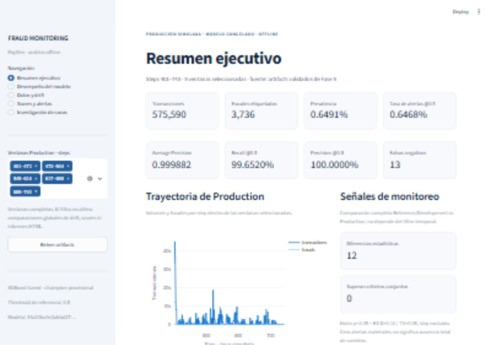

# Fase 6 — Professional Monitoring Dashboard

## Resumen

Dashboard Streamlit local para explorar resultados reales de Fase 5. Cinco vistas con navegación lateral, KPIs validados, gráficos Plotly, tablas con búsqueda y descarga, filtros temporales por ventanas completas y acceso a cinco informes HTML existentes. Modelo XGBoost, features y threshold de referencia 0.5 permanecen congelados. No se utiliza Production para tuning.

Production completo: 575590 transacciones, 3736 fraudes, steps 401–743. AP 0.9998817696921924; ROC-AUC 0.9999990261867279; precision 1; recall 0.9965203426124197; F2 0.9972143354582954. TP 3723, FP 0, TN 571854, FN 13. Estas cifras se leen de artifacts; no son constantes de presentación.

## Arquitectura

- `app/main.py`: presentación, cinco vistas, filtros, caching Streamlit y descargas.
- `app/data_access.py`: lectura de ocho CSV pequeños y dos JSON; validación de schemas, períodos, congelamiento, matrices, métricas derivadas, ventanas, Top-K y reglas de drift; rutas restringidas al proyecto.
- `.streamlit/config.toml`: tema claro coherente, servidor local y telemetría desactivada.
- `tests/test_dashboard.py`: pruebas de la capa de datos sin arrancar Streamlit.

La app no importa modelos, MLflow, Evidently, SHAP ni Optuna y no lee el CSV raw. Cache por tamaño/mtime de artifacts; botón Releer artifacts. HTML y explicaciones existentes tienen caches separados. No se ejecuta scoring masivo ni se regeneran informes al navegar. Cambios inconsistentes o archivos esenciales faltantes producen mensajes claros, sin fabricar valores.

## Vistas

| Vista | Contenido |
|---|---|
| Resumen ejecutivo | Volumen, fraude, prevalencia, AP, precision, recall, alert rate, FN; evolución por step, comparación global Validation/Production y señales de drift |
| Desempeño del modelo | AP, ROC, precision, recall, F1/F2; matriz, ventanas, Top-K observado y capacidad máxima teórica; FN de la selección |
| Datos y drift | Filtro por variable, diferencias estadísticas y efecto práctico, tabla y magnitud respecto al criterio; comparaciones binarias y diagnósticos dentro de tipo |
| Scores y alertas | Distribución persistida, percentiles interactivos, score shift global, alert rate temporal y prevalencia |
| Investigación de casos | Período, categoría e índice reproducible anónimo; FN, casos atípicos y explicaciones SHAP existentes de Validation claramente separadas |

No hay SHAP Production exportado. No se atribuyen explicaciones de Validation a casos Production. No se exponen nombres de cuentas.

## Fuentes de datos y alcance

| Artifact | Uso |
|---|---|
| production_model_comparison.csv | Comparación global, matrices, AP/ROC, Top-K y métricas |
| monitoring_windows.csv | Conteos y ranking persistido por ventana |
| production_step_profile.csv | Volumen, fraudes, alertas y FN por step |
| monitoring_summary.json | Estado COMPLETE, identidad y coherencia con métricas y drift |
| production_monitoring_freeze.json | Threshold, ventanas y criterios congelados |
| data_drift_features.csv | Magnitudes, Holm p-values, estado estadístico/práctico |
| type_conditioned_drift.csv | Diagnósticos por tipo de transacción |
| monitoring_scores.csv | Resúmenes y percentiles globales de scores |
| monitoring_by_type.csv | Desempeño por tipo |
| monitoring_atypical_cases.csv | Casos reales exportados, índices anónimos y categorías |
| local_explanations.csv y waterfall PNG de Fase 4 | SHAP existente de Validation |
| reports/figures/monitoring | Distribución de scores persistida |

La guía `docs/dashboard_user_guide.md` detalla cada KPI, actualización y límites.

## Filtros matemáticamente válidos

Conteos de ventanas disjuntas se suman y precision, recall, F1, F2, prevalencia y alert rate se derivan de esos conteos. Todas las ventanas recuperan el ranking global persistido; una sola ventana utiliza su ranking persistido. Un subconjunto de varias ventanas muestra AP/ROC y Top-K observado como No disponible, porque no hay scores individuales persistidos para recomponer ese ranking; no se promedian AUC. La capacidad máxima teórica usa ceil(n × fracción)/fraudes, acotada a 1.

Se verificó en navegador la selección no contigua de ventanas 0 y 2: 4 FN y AP/ROC no disponibles. Una sola ventana 0 recupera AP 0.999918 y 2 FN. Los gráficos por step no unen intervalos omitidos. Selección vacía muestra un mensaje. Drift, percentiles globales, comparación global y HTML se etiquetan como globales y no simulan cambiar con filtros temporales. Casos por categoría son ejemplos exportados, no una muestra exhaustiva de toda la población.

## Reportes HTML

Cinco descargas desde los archivos originales, sin duplicarlos en el repositorio:

- reports/monitoring/data_drift.html
- reports/monitoring/prediction_drift.html
- reports/monitoring/performance_monitoring.html
- reports/monitoring/evidently_data_drift.html
- reports/monitoring/evidently_prediction_drift.html

Se validaron las cinco rutas y botones. Se realizó una descarga real de data_drift.html en navegador: 11410 bytes, exactamente iguales al original. Los informes completos y los informes Evidently de PSI muestral conservan su alcance y metodología de Fase 5. Archivo HTML faltante muestra advertencia específica.

## Verificación funcional y visual

Servidor local iniciado en 127.0.0.1:8501. Se revisaron las cinco vistas en navegador a 1280 × 900: navegación, KPIs, gráficos, matriz, tablas, casos FN, filtros completos/single/múltiples y acceso HTML. Se corrigió el espacio superior para que el encabezado no quede cubierto por la barra de Streamlit. El viewport de prueba fue restaurado al terminar.

Capturas reales:

- [Resumen ejecutivo](reports/figures/dashboard/executive_overview.png)
- [Desempeño](reports/figures/dashboard/performance.png)
- [Datos y drift](reports/figures/dashboard/data_drift.png)
- [Scores y alertas](reports/figures/dashboard/prediction_monitoring.png)
- [Investigación de casos](reports/figures/dashboard/case_investigation.png)
- [Ventanas no contiguas](reports/figures/dashboard/filtered_windows.png)



## Tests

`uv run python -m pytest -q`: **57 passed, 4 warnings in 12.54s**. Las advertencias corresponden a deprecaciones de SHAP/SQLAlchemy en pruebas existentes. No fallos.

11 pruebas nuevas del dashboard pasaron también aisladamente en 0.89 s: carga real, archivos faltantes, corrupción CSV/JSON, integridad de ventanas, conteos y ratios, ranking global/single, indisponibilidad multiventana, selección vacía/inválida, filtrado no contiguo, cinco rutas HTML y protección de rutas, métricas indefinidas y ausencia de imports de cómputo pesado/raw. pytest no arranca Streamlit.

## Limitaciones e interpretación

PaySim es una simulación offline, no streaming real ni un servicio de alertas. No se inventaron timestamps, incidentes o datos. Las métricas excepcionalmente altas deben interpretarse con las limitaciones del simulador y las relaciones estructurales ya documentadas.

12 variables presentan diferencias estadísticas; 0 superan los criterios conjuntos predefinidos. Esto no demuestra ausencia total de cambios. Step es separación temporal estructural y está excluido de esos conteos. Prediction drift no demuestra automáticamente concept drift; este último no está establecido concluyentemente. 12 de los 13 FN globales tienen amount=0 y oldbalanceOrg=0. No se cambia el threshold por estos hallazgos.

No hay distribuciones numéricas individuales persistidas para reconstruir histogramas arbitrarios con filtros; se ofrecen resúmenes/figuras existentes e informes HTML. Ranking de subconjuntos multiventana no disponible por la razón anterior. Visual QA realizada en escritorio; para panel estrecho se recomienda colapsar la barra lateral y desplazar tablas horizontalmente.

## Ejecución PowerShell

Desde la raíz del proyecto:

```powershell
$env:UV_CACHE_DIR = Join-Path $PWD '.uv-cache'
uv sync --locked
uv run streamlit run app/main.py --server.address 127.0.0.1 --server.port 8501 --server.headless true --browser.gatherUsageStats false
```

Abrir http://127.0.0.1:8501. Ctrl+C detiene el servidor. Si el puerto está ocupado, elegir otro con --server.port. No es necesario volver a ejecutar Fase 5 para abrir el dashboard cuando sus artifacts ya están disponibles.

## Archivos y Git

Creados: app/__init__.py, app/data_access.py, app/main.py, .streamlit/config.toml, tests/test_dashboard.py, docs/dashboard_user_guide.md, este reporte y seis capturas en reports/figures/dashboard/. Actualizados README.md, pyproject.toml y uv.lock para Streamlit/Plotly.

Rama verificada: development. Working tree conserva cambios locales de fases anteriores y los de esta fase; sin commit adicional, remoto nuevo, push, PR, merge o release. No se modificó credit-risk-ml ni se subieron raw/secretos. Modelo congelado verificado por SHA256, sin inferencia ni reentrenamiento. Las rutinas de monitoreo e interpretación previas permanecen intactas.

Duración medida de implementación/verificación desde la creación de app/data_access.py hasta el cierre: aproximadamente 17 minutos; no incluye preparación anterior a ese archivo. Suite completa: 12.54 s.

## Pendientes de Fase 7

Fase 7 queda pendiente de una instrucción nueva y alcance específico. No se inició deployment, streaming, cloud, GitHub Actions ni trabajo de esa fase. No hay bloqueos de Fase 6 ni decisiones necesarias para usar el dashboard local.

PHASE 6: COMPLETE
