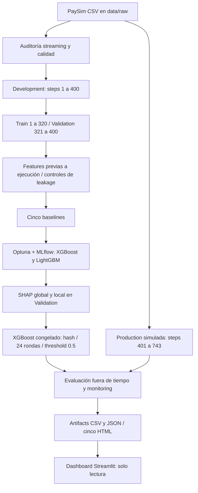

# Fraud detection · ML monitoring

Proyecto del Curso III de Machine Learning Engineering: clasificación supervisada de fraude transaccional sobre PaySim. **Preparación local de v1.0.0**; publicación GitHub, enlace externo de experimentos, PR y release pendientes de autorización. [Auditoría](PHASE_7_DELIVERY_AUDIT.md) · [Remediación](PHASE_7A_REMEDIATION_REPORT.md).

## Problema y objetivo de negocio

Cada transacción se clasifica usando `isFraud` como target. El objetivo es priorizar revisión de operaciones sospechosas con alta captura de fraude y bajo volumen de falsas alertas. El scoring académico se sitúa antes de ejecutar la transacción: utiliza monto solicitado, tipo y balances anteriores asumidos disponibles. Se evalúan precision/recall/F2 y capacidad de revisión Top-K, sin inventar costos monetarios o SLA. El análisis es retrospectivo sobre producción simulada; no es un servicio bancario ni monitoreo en tiempo real.

## Arquitectura



## Dataset y diccionario

Fuente: [Synthetic Financial Datasets for Fraud Detection — PaySim](https://www.kaggle.com/datasets/ealaxi/paysim1), Edgar Lopez-Rojas; licencia indicada por la fuente CC BY-SA 4.0. Atribución: Lopez-Rojas, Elmir y Axelsson, *PaySim: A financial mobile money simulator for fraud detection*, EMSS 2016. [Descarga y verificación](data/README.md).

Archivo `PS_20174392719_1491204439457_log.csv`: 493,534,783 bytes, 6,362,620 filas y 11 columnas. 8,213 fraudes (0.129082%), cero nulos y cero duplicados textuales exactos según auditoría completa. La consigna describe 744 horas; el archivo observado contiene steps 1–743. Una hora de simulación no se convierte en una fecha real. El raw nunca se versiona.

| Variable | Significado | Uso |
|---|---|---|
| step | Hora de simulación | Predictor y segmentación temporal |
| type | CASH_IN, CASH_OUT, DEBIT, PAYMENT, TRANSFER | Dummies fijas y categoría desconocida |
| amount | Importe en moneda local | Predictor previo |
| nameOrig | Identificador del iniciador | Excluido por memorización |
| oldbalanceOrg | Saldo anterior del origen | Predictor, disponibilidad asumida |
| newbalanceOrig | Saldo posterior del origen | Excluido por información posterior |
| nameDest | Identificador del destinatario | Solo prefijo M como proxy merchant |
| oldbalanceDest | Saldo anterior del destinatario | Predictor; información merchant no disponible según diccionario |
| newbalanceDest | Saldo posterior del destinatario | Excluido; misma limitación merchant |
| isFraud | Fraude generado por agentes del simulador | Target binario, nunca predictor |
| isFlaggedFraud | Marca de regla de transferencias masivas; diccionario describe límite 200,000 | Excluida como señal de decisión existente |

## Segmentación temporal

| Segmento | Steps | Filas | Fraudes | Prevalencia |
|---|---|---:|---:|---:|
| Train | 1–320 | 4,388,788 | 3,609 | 0.082232% |
| Validation | 321–400 | 1,398,242 | 868 | 0.062078% |
| Reference (Development completo) | 1–400 | 5,787,030 | 4,477 | 0.077363% |
| Production simulada | 401–743 | 575,590 | 3,736 | 0.649073% |

Corte 320 prefijado como 80% de pasos, no 80% de filas; suficiente soporte positivo verificado. Sin split aleatorio global, resampling o balance artificial de Validation/Production. Production no se usa para tuning, early stopping, selección, calibración o threshold.

## Features y prevención de leakage

14 columnas en orden fijo: step, amount, oldbalanceOrg, oldbalanceDest, amount_to_oldbalanceOrg, orig_balance_zero, orig_balance_emptied, dest_is_merchant, cinco dummies de type y type_UNKNOWN. El ratio con denominador cero usa 0 más indicador. Vaciado: saldo previo positivo y diferencia absoluta monto–saldo ≤0.01. Ingeniería float64 y matrices históricas float32. No se alteraron estas features en la entrega.

Se excluyen balances posteriores/residuales, IDs completos, flag y target. Transformaciones por fila; scaler de regresión logística ajustado solo en Train. Production se filtra antes de generar matrices Development. Step puede capturar programación del simulador y no generalizar fuera de Train. [Catálogo y controles](docs/feature_catalog.md) · [Preprocesamiento](notebooks/01_preprocessing.ipynb).

## Algoritmos y optimización

Baselines: Dummy prior, LogisticRegression con StandardScaler/class weights, RandomForest ponderado, XGBoost y LightGBM. Train completo, seed 42, cuatro workers para árboles. LightGBM baseline usa limitación de leaf update `max_delta_step=1.0`, documentada como corrección de estabilidad en Fase 2.

Optuna usa TPE secuencial seed 42, cinco trials de inicio, configuración baseline encolada y maximiza Average Precision exacta de Validation. Búsqueda acotada de complejidad, learning rate, regularización, subsampling y pesos: máximo 20 trials por algoritmo, mínimo 10 antes del criterio de saturación. Se completaron 10 por algoritmo. Early stopping interno de estimador; Validation reutilizada para selección, por lo que las métricas tuned son estimaciones de desarrollo. XGBoost early stopping usa aucpr interpolada, distinta de AP exacta del objetivo Optuna. [Protocolo y espacios](PHASE_3_OPTIMIZATION_MLFLOW_REPORT.md).

## Resultados verificados

`pr_auc` significa **Average Precision** no interpolada, no área trapezoidal. Precision/recall/F2 y FP/FN usan score ≥0.5. Este threshold es fijo de evaluación, no un threshold bancario optimizado. Tablas leídas de artifacts históricos sin reentrenar; redondeo de presentación a nueve decimales.

### Baselines en Validation

| model | pr_auc | roc_auc | precision_05 | recall_05 | f2_05 | fp | fn |
| --- | --- | --- | --- | --- | --- | --- | --- |
| Dummy | 0.000620780 | 0.500000000 | 0.000000000 | 0.000000000 | 0.000000000 | 0 | 868 |
| LogisticRegression | 0.998849661 | 0.999525441 | 0.997698504 | 0.998847926 | 0.998617830 | 2 | 1 |
| RandomForest | 0.999997347 | 0.999999998 | 0.996555683 | 1.000000000 | 0.999309233 | 3 | 0 |
| XGBoost | 0.999759503 | 0.999999817 | 1.000000000 | 0.998847926 | 0.999078129 | 0 | 1 |
| LightGBM | 0.999993402 | 0.999999996 | 1.000000000 | 0.997695853 | 0.998155832 | 0 | 2 |

### Comparación y optimización

| model | variant | pr_auc | recall_05 | fp | fn |
| --- | --- | --- | --- | --- | --- |
| LogisticRegression | baseline | 0.998849661 | 0.998847926 | 2 | 1 |
| RandomForest | baseline | 0.999997347 | 1.000000000 | 3 | 0 |
| XGBoost | baseline | 0.999759503 | 0.998847926 | 0 | 1 |
| LightGBM | baseline | 0.999993402 | 0.997695853 | 0 | 2 |
| XGBoost | tuned | 0.999918590 | 0.998847926 | 0 | 1 |
| LightGBM | tuned | 1.000000000 | 0.000000000 | 0 | 868 |

LightGBM tuned tiene ranking perfecto (AP=1) pero recall=0 a 0.5: ranking y decisiones a un threshold no son equivalentes. XGBoost fue seleccionado entre candidatos tuned en banda práctica AP de 0.0001, considerando Top0.1%, errores, latencia y complejidad. No se declara inferior al fuerte baseline RF ni superioridad estadística. Se conserva exactamente ese champion para la producción académica simulada.

### Offline y online simulada

| period | observations | frauds | pr_auc | roc_auc | precision_05 | recall_05 | f2_05 | fp | fn |
| --- | --- | --- | --- | --- | --- | --- | --- | --- | --- |
| Validation | 1398242 | 868 | 0.999918590 | 0.999999972 | 1.000000000 | 0.998847926 | 0.999078129 | 0 | 1 |
| Production | 575590 | 3736 | 0.999881770 | 0.999999026 | 1.000000000 | 0.996520343 | 0.997214335 | 0 | 13 |

Fuente: [comparación persistida](artifacts/production_model_comparison.csv). Production: TP 3,723, TN 571,854, FP 0 y FN 13. Alert rate 0.646815%. Doce FN tienen amount=0 y oldbalanceOrg=0. Top0.1% permite revisar 576 filas y captura 15.417559% del fraude Production; su capacidad limita la captura pese al excelente ranking. Validation Top0.1% (1,399 filas) captura 100%. No comparar AP sin considerar la prevalencia distinta. Online simulada significa evaluación etiquetada del segmento posterior; **sin métricas en tiempo real**.

## Modelo y MLflow / preparación DagsHub

Champion congelado: [models/XGBoost.ubj](models/XGBoost.ubj), 77,796 bytes, SHA256 `44a20bc0e2abbd276ae94790db404248d2ab2c5d01025b00b2e4f935b6f220e4`. [Manifiesto](models/manifest.json): 14 features, 24 rondas efectivas, threshold 0.5, run fuente `1d353308f1e3427094a221667f3da9de`. Se versiona una copia idéntica; no requiere LFS. [Recuperación y carga](docs/model_recovery.md).

MLflow local tiene 31 runs FINISHED: 29 de optimización/comparación, uno SHAP y uno monitoring. Parámetros, métricas, modelos nativos y artifacts están presentes. Model Registry/flavor MLflow no se implementaron. El store y sus 145 archivos permanecen fuera de Git. `localhost` no es evidencia accesible para un evaluador remoto. [MLflow y plan DagsHub](docs/mlflow_dagshub_setup.md): publicación de runs existentes pendiente, sin reentrenar ni inventar enlace.

## Interpretabilidad SHAP

Tree SHAP exacto, tree-path-dependent, solo 24 rondas efectivas del XGBoost, contribuciones en log-odds. Muestra: 868 fraudes y 2,000 no fraudes de Validation; importancia ponderada por prevalencia se presenta aparte. Vaciado aproximado domina, seguido de señales de monto/saldo/ratio. Gain y SHAP miden cosas diferentes. El modelo detecta 15 de 16 fraudes Validation fuera de la regla de vaciado; se explica localmente el único FN de monto/saldo cero. No hay FP a 0.5; no se inventa un caso FP. SHAP no demuestra causalidad ni probabilidad calibrada. [Análisis](docs/model_interpretability.md) · [Notebook](notebooks/04_interpretability.ipynb).

## Monitoreo

Data drift full-data con KS/TV, Holm y umbrales prácticos congelados; 12 variables con cambios estadísticos, cero alertas conjuntas. Step es separación estructural y no cuenta como alerta. Esto no demuestra ausencia de cambios relevantes en features raras. Evidently complementa con muestras uniformes de 25,000 por período y PSI 0.2, diseño distinto.

Prediction monitoring compara scores, percentiles y alert volume; performance compara etiquetas, FP/FN, soporte y ventanas de 72 horas. Scores ponderados no son probabilidades calibradas. Concept drift **no establecido concluyentemente**; cambios de mezcla/prevalencia no prueban cambio de P(Y|X). [Fase 5](PHASE_5_MONITORING_REPORT.md) · [Notebook](notebooks/05_monitoring.ipynb).

## Dashboard y HTML

Streamlit: cinco vistas (resumen, desempeño, datos/drift, scores/alertas, investigación), gráficos Plotly, filtros por ventanas completas y descargas reales. Solo lee artifacts pequeños; no scoring, entrenamiento o cómputo SHAP al navegar. No hay explicaciones SHAP Production. AP/ROC/Top-K de subsets multiventana arbitrarios no disponibles, porque no se guardaron scores individuales; no promediar AUC. [Guía](docs/dashboard_user_guide.md).

Reportes para abrir localmente o descargar desde dashboard:

- [Data drift](reports/monitoring/data_drift.html)
- [Prediction drift](reports/monitoring/prediction_drift.html)
- [Performance](reports/monitoring/performance_monitoring.html)
- [Evidently data drift](reports/monitoring/evidently_data_drift.html)
- [Evidently prediction drift](reports/monitoring/evidently_prediction_drift.html)

## Instalación y ejecución Windows / PowerShell

Desde raíz del proyecto, instalar uv y usar Python fijado en `.python-version`. [Procedimiento completo](docs/reproduction.md).

```powershell
$env:UV_CACHE_DIR = Join-Path $PWD '.uv-cache'
$env:DO_NOT_TRACK = '1'
$env:MLFLOW_DISABLE_TELEMETRY = 'true'
New-Item -ItemType Directory -Force tmp | Out-Null
$env:TEMP = Join-Path $PWD 'tmp'
$env:TMP = $env:TEMP
uv sync --locked
uv run python -m pytest -q -p no:cacheprovider
uv run python scripts/verify_delivery.py --notebooks
uv run streamlit run app/main.py --server.address 127.0.0.1 --server.port 8501 --server.headless true --browser.gatherUsageStats false
```

Abrir `http://127.0.0.1:8501`; Ctrl+C detiene Streamlit. CSV/matrices/store MLflow no necesarios para revisar notebooks/dashboard/HTML. Para validar raw, descargar según `data/README.md` y ejecutar `uv run python scripts/verify_delivery.py --raw`. Scripts resuelven raíz por `__file__`; notebooks desde raíz/notebooks o mediante verificador. Primera instalación requiere red si paquetes no cacheados; la reproducción pesada necesita varios GB RAM/disco y **no forma parte de revisión de entrega**. No ejecutar productores de fases para abrir resultados existentes.

## Estructura y estrategia Git

```text
app/                       Dashboard y acceso validado a datos
artifacts/                 CSV/JSON pequeños de evidencia
models/                    Champion idéntico + manifiesto
notebooks/                 01 preprocessing, 02 training, 03 tuning, 04 SHAP, 05 monitoring
data/raw/                  CSV original ignorado
data/processed/            Matrices/modelos locales ignorados
src/fraud_detection/       Lógica reutilizable
scripts/                   Productores históricos y verificador de entrega
reports/figures/            Gráficos y capturas
reports/monitoring/         Cinco HTML
docs/                      Instalación, Git, tracking, catálogo y guías
 tests/                    Tests sintéticos y portabilidad
mlruns/, mlartifacts/       Solo locales, ignorados
```

[Política Git](docs/git_strategy.md): development para cambios y commits locales; main para integración mediante PR revisada. Fase 7A no altera main. GitHub, PR integrada, tag/release v1.0.0 y enlace externo de experimentos requieren autorización Fase 7B. Raw, secretos, bases y temporales excluidos. Metadata 0.1.0 durante preparación; release aún no creada.

## Limitaciones y conclusiones

PaySim contiene reglas estructurales muy discriminantes. Resultados casi perfectos no prueban capacidad bancaria; la disponibilidad real de balances y semántica merchant debe verificarse. Reutilización de Validation induce optimismo; hay un solo período fuera de tiempo. Dependencia temporal limita inferencia estadística; AP depende de prevalencia. No se calibraron scores ni optimizaron costos o threshold con Production. No hay AutoML, streaming, cloud ni servicio de alertas.

El pipeline mantiene separación temporal y controles de leakage; XGBoost congelado captura 3,723 de 3,736 fraudes Production sin FP observados. Errores de monto cero y mayor carga de alertas merecen revisión operacional; no justifican modificar el modelo tras mirar Production. SHAP y monitoring permiten explicar límites de la regla dominante y cambios observados, sin afirmar concept drift. La entrega técnica local es revisable; su publicación y accesibilidad externa aún están pendientes.

## Evidencia por fase

[1 Auditoría](INITIAL_DATA_AUDIT.md) · [2 Modelado](PHASE_2_MODELING_REPORT.md) · [3 Optimización](PHASE_3_OPTIMIZATION_MLFLOW_REPORT.md) · [4 Interpretabilidad](PHASE_4_INTERPRETABILITY_REPORT.md) · [5 Monitoring](PHASE_5_MONITORING_REPORT.md) · [6 Dashboard](PHASE_6_DASHBOARD_REPORT.md). Los reportes históricos describen el alcance al cerrar cada fase; sus rutas/estados son procedencia y se conservan autenticados.
